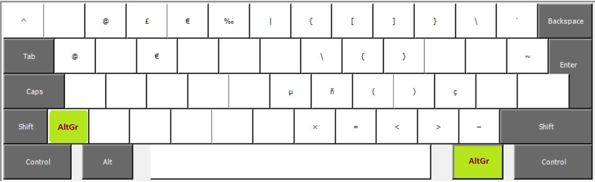

# Ein deutsches Tastaturlayout mit viel besserem Zugriff auf Sonderzeichen

Dieses Layout ist ein Lebensretter für Programmierer, die viel `{}` und `[]` und `()` und `\` oder `|` und Dinge wie `<=` oder `>=` tippen müssen. 
Aber auch für alle anderen ist es sehr praktisch!
Und nebenbei enthält es noch ein paar zusätzliche Zeichen. 
Hast Du Dich schonmal gefragt, warum die deutsche Tastatur Zeichen für `$` und `€` hat, aber nicht `¢` oder `£`? Ab heute brauchst Du Dich nicht mehr wundern, denn es gibt die Zeichen jetzt!

Dieses Repo enthält die Konfiguration für Windows. 
Seit neuestem gibt es ein Schwester-Repo [xkb-de-l3](https://github.com/matey-jack/xkb-de-l3) mit einer sehr ähnlichen Konfiguration für Linux.

## Die Belegung der AltGr Ebene

Hier als Screenshot vom Microsoft Keyboard Layout Creator.

Zur Übersicht wiederhole ich im Folgenden nochmal die ersten beiden Ebenen (Taste bzw. Shift+Taste) der deutschen Tastatur und schreibe drunter jeweils die Belegung der dritten und vierten Ebene (AltGr+Taste und Shift+AltGr+Taste).
Die vierte Ebene ist nur dort belegt, wo es logisch ist, um Zeichen leichter zu finden.
Zum Beispiel ist Shift+ç = Ç und Shift+ñ = Ñ.

    ^° 1! 2” 3§ 4$ 5% 6& 7/ 8( 9) 0= ß? ´`  ⌫⌫
    ^   ¡ @  £¥ €¢ ‰  |  {  [  ]  }  \¿ ´
    
     ↹  Q  W  E  R  T  Z  U  I  O  P  Ü  +*  ↵↵↵
         @     €           \  {  }        ~
    
     ⇧⇧⇧  A  S  D  F  G  H  J  K  L  Ö  Ä  ’# ↵↵
                         µ  ñÑ (  )  çÇ
    
     ⇧⇧  ¤¤  Y  X  C  V  B  N  M  ,; .: -_   ⇧⇧⇧
                            ×  =  <  >  –

Besonders bemerkenswert ist der "Stapel der Klammern": [] liegen genau wie im deutschen Layout normalerweise und mit denselben Fingern kann man in den darunter-liegenden Zeilen auch alle anderen Klammern erreichen. 
`()` sind die wichtigsten Klammern und liegen auf der Grundreihe. Schließlich liegen `<>` auf denselben Tasten wie im US ANSI Layout, nur eben auch auf der AltGr-Ebene, wie die anderen Klammern. 
Die alten "qwertz" Positionen der Klammern funktionieren immer noch, sodass man auch nicht durcheinander kommt, wenn man aus Gewohnheit (oder den Tastenbeschriftungen folgend) mal diese tippt.
Für JavaScript und Markdown braucht man manchmal den Backtick `` ` ``, den die deutsche Tastatur nur als [Akzenthinzufügetaste](https://www.wikiwand.com/de/articles/Tottaste) hat (Eingabe durch Shift+Akzent gefolgt von Leertaste). 
Hier im Layout bekommt man ihn jetzt einfach als AltGr+Akzent.
Dasselbe gibt es auch für `^` – mit AltGr bekommt man sofort ein `^`, dass sich nicht als Akzent auf den nächsten Buchstaben setzt. 

#### Kompatibilität, oder "kann man noch normal tippen?"

Ich habe der Versuchung widerstanden `\` von der `ß` Taste zu entfernen und auf AltGr+/ zu legen, was sehr logisch wäre, aber dann würde die alte Position von `{` nicht mehr funktionieren. 
Ebenso wären `¡` und `¿` natürlich auf der AltGr-Ebene leichter zu erreichen als AltGr+Shift, aber auch dazu müsste `\` die alte Position aufgeben, was zu Verwirrung kommen kann.

Nur bei einer Taste habe ich der Versuchung nicht widerstanden und eine inkompatible Änderung gemacht: im qwertz-Standard gibt es die Taste `#'`, aber bei mir gibt es stattdessen `'#`.
Denn der einfache Anführungsstrich wird in verschiedenen Funktionen bei mir sehr häufig benutzt. 
Zum einen in der Programmierung, zum anderen als Apostroph im Englischen. 

## Eine gut belegte Ebene braucht auch auf jeder Hand eine Aktivierungstaste

Um die Hände zu schonen, empfiehlt es sich, auch auf der linken Seite der Tastatur eine AltGr Taste einzurichten.
Ich empfehle dazu die `<>|` Taste zu verwenden. 
An deren Stelle steht in der Abbildung schon `¤¤` als Symbol für AltGr.
Alternativ kann man auch CapsLock verwenden, aber wer wirklich seine Hände schonen möchte, der sollte CapsLock lieber die Funktion als zusätzliche Shift-Taste geben. 
(Das mache ich seit über zehn Jahren und es tut den Finger echt gut!)

## Umbelegung von "Nicht-Zeichen" Tasten wie AltGr und Shift

Weil man mit einem "Internationalen Tastaturlayout" unter Windows keine Sondertasten wie AltGr und CapsLock ändern kann, gibt es für diese Änderung einen anderen Mechanismus. 
Es gibt eine Einstellung in der Windows-Registry, die eine sehr technische Codierung der Belegungsänderung erfordert.
(Details dazu unter [scancode-mappings/ReadMe.md](scancode-mappings/ReadMe.md))

Passend zu obigem Tasten-Layout gibt es hier fertige Mappings zum Auswählen und Anklicken. 

#### ¡Zur Aktivierung der Änderungen muss Windows einmal neu gestartet werden!

Meine Empfehlung:
 * [Nutze CapsLock als Shift und `<>|` als AltGr](scancode-mappings/Use_CapsLock_as_Shift_and_LessGreater_as_AltGr.reg)

Andere Alternativen:
 * [Nutze CapsLock als Shift](scancode-mappings/Use_CapsLock_as_Shift.reg)
 * [Nutze `<>|` als AltGr](scancode-mappings/Use_LessGreater_as_AltGr.reg) 
 * [Nutze CapsLock als AltGr](scancode-mappings/Use_CapsLock_as_AltGr.reg) 

Beachte, dass jede Konfiguration alle anderen überschreibt. 
Wer zwei Änderungen möchte, braucht eine Konfiguration, die beides enthält!
